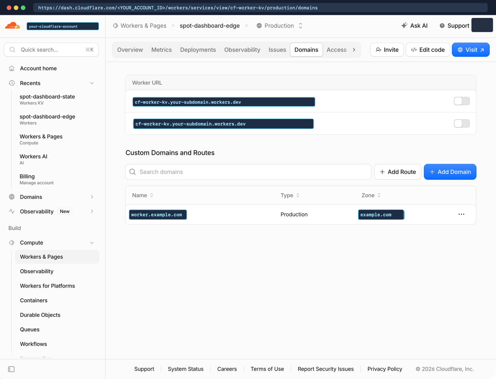

# Cloudflare worker and `KV` state template

This repository (`swack-tools/webassemply-template`) is a reusable template for building 100% pure-Rust serverless WebAssembly apps on **Cloudflare Workers** (`workers-rs`, compiled to `wasm32-unknown-unknown`) that bind **Cloudflare Workers `KV`** directly via `worker::kv::KvStore`, while remaining natively portable to **`wasmCloud` on Kubernetes** (`wasm32-wasip2` + `wasmcloud:keyvalue` / `wasi:keyvalue/store`).

It works out of the box with **Claude Desktop and Claude Code**, **ChatGPT and OpenAI Codex Desktop**, and **Google Antigravity Desktop and IDE**, enforces the **Google developer documentation style guide** with **Vale**, and publishes a strict **MkDocs Material** documentation site to **GitHub Pages**.

## Wasm at Cloudflare's edge and `wasmCloud` portability

- **Wasm at Cloudflare's edge + `KV` (`wasm32-unknown-unknown`)**:
  - Write Wasm components in Rust using `workers-rs` (`worker` crate) compiled to `wasm32-unknown-unknown` via `worker-build --release`.
  - Bind Cloudflare Workers `KV` directly via `worker::kv::KvStore` (`env.kv("STATE_KV")?`), which implements the [`KvStoreBackend`](cloudflare/src/state.rs) trait directly.
- **`wasmCloud` with Rust workers on Kubernetes (`wasm32-wasip2`)**:
  - Bridge `wasi:keyvalue/store` (`wasmcloud:keyvalue`) buckets through [`WasiKeyValueBucket`](cloudflare/src/state.rs) and [`WasmCloudKvAdapter`](cloudflare/src/state.rs).
  - Run the exact same `StateBundle` state machine, `SHA-256` fingerprint diff-gating, distributed `KV` leases, and `HMAC-SHA256` session authentication natively on both Cloudflare Workers and `wasmCloud` on Kubernetes (backed by NATS JetStream or Redis). See [Run Rust WebAssembly on Cloudflare edge and wasmCloud](docs/wasmcloud-and-cloudflare-edge.md).

## Template highlights

- **Quota-conserving Cloudflare `KV` state engine (`cloudflare/src/state.rs`)**:
  - Consolidates all app state into a single versioned `KV` document (`app:state`, schema `cf-kv-state-snapshot-v1`).
  - Caches parsed state in Wasm isolate memory (`thread_local!`) with a 60-second time to live (`TTL`) for sub-0.1 ms warm reads.
  - Computes canonical `SHA-256` state fingerprints (`state_fingerprint`) so scheduled cron ticks skip `kv.put(...)` when state is unchanged (`WriteOutcome::SkippedUnchanged`).
  - Guards concurrent cron reconcilers with distributed `KV` leases (`app:lease`) and monotonic `state_version` increments.
  - Abstracts storage behind `KvStoreBackend` so `cargo test` runs entirely in memory on macOS and Linux via `InMemoryKvStore`.
- **Constant-time `HMAC-SHA256` authentication (`cloudflare/src/auth.rs`)**:
  - Purpose-separated `HMAC-SHA256` session cookies (`__Host-cf_kv_session`), `SESSION_NOT_BEFORE` instant global revocation, and constant-time digest verification (`subtle::ConstantTimeEq`).
- **Pre-configured multi-harness AI routing**:
  - [CLAUDE.md](CLAUDE.md): begins with `@read AGENTS.md` on line 1 and defines the Claude subagent routing policy (`fable` / `opus-5.5`, `opus`, `sonnet` / `sonnet-5.5`, and `haiku` / `haiku-5.5`).
  - [AGENTS.md](AGENTS.md): shared repository guidelines, `KV` invariants, security rules, Codex routing (`gpt-6-astra`, `gpt-6.1-sol`, `gpt-6-luna`), and the Claude routing guide at the end of the file.
  - [GEMINI.md](GEMINI.md) and [.agents/rules/routing.md](.agents/rules/routing.md): configures Google Antigravity Desktop and IDE routing modules (`Gemini 4 Argon` at `High` effort, `Gemini 3.8 Flash` at `High` and `Medium` effort, and `Gemini 3.5 Flash-Lite` at `High` effort) plus workspace isolation rules.
- **Vale Google style linting and GitHub Pages automation**:
  - [.vale.ini](.vale.ini) enforcing `BasedOnStyles = Google` across all root and `docs/` Markdown files.
  - [mkdocs.yml](mkdocs.yml) and [.github/workflows/docs.yml](.github/workflows/docs.yml) for strict MkDocs Material builds and commit-SHA-pinned GitHub Pages deployment.

## Repository layout

| Path | Description |
| --- | --- |
| `CLAUDE.md` | Claude Desktop and Claude Code entrypoint (`@read AGENTS.md` + Claude subagent routing policy). |
| `AGENTS.md` | Cross-harness AI agent guidelines, `KV` state contracts, Git review gates, Codex routing, and Claude routing guide. |
| `GEMINI.md` | Google Antigravity Desktop (2.0) and IDE model routing modules and workspace isolation rules. |
| `.agents/rules/routing.md` | Workspace-scoped Antigravity routing rule discovered automatically by Antigravity. |
| `cloudflare/` | Pure-Rust Cloudflare Worker crate (`cf-worker-kv-template`) with HTTP router, `KV` state engine, `HMAC` auth, cron reconciler, embedded UI, and test suite. |
| `docs/` | MkDocs Material documentation pages verified by Vale. |
| `.vale.ini` | Vale configuration enforcing the Google developer documentation style guide. |
| `mkdocs.yml` | Strict MkDocs Material site configuration for GitHub Pages. |
| `justfile` | Task runner recipes for testing, Wasm compilation, formatting, and Vale prose checks. |

## Quick start

### Run native tests

All state, authentication, lease-locking, and reconciler tests run natively with `cargo test` without requiring a live Cloudflare account:

```bash
cargo test --manifest-path cloudflare/Cargo.toml
```

### Build the worker bundle

Compile the Rust crate to `wasm32-unknown-unknown` and generate the JavaScript Worker shim:

```bash
cd cloudflare && worker-build --release && cd ..
```

### Run prose style checks

Synchronize the `Google` style package and lint every Markdown file in the repository:

```bash
vale sync
vale README.md AGENTS.md CLAUDE.md GEMINI.md docs/*.md
```

## Visual configuration walkthrough

See [Customize GitHub runners for swack-tools and create the Cloudflare control plane](docs/customizing-github-runners-and-cloudflare.md) and [Style guide and GitHub Pages setup](docs/style-guide-and-github-pages.md) for all 14 step-by-step screenshots with sensitive identifiers scrubbed:

1. **Create and bind the `STATE_KV` namespace (`Storage & databases > Workers KV`)**:

   

2. **Configure encrypted runtime secrets, variables, and `KV` bindings (`Settings > Variables and secrets`)**:

   

3. **Bind a custom domain and turn off `workers.dev` preview URLs (`Domains`)**:

   

4. **Inspect the live pure-Rust edge Worker dashboard hydrated from `STATE_KV`**:

   

## Documentation map

- [Documentation home](docs/index.md)
- [KV state architecture](docs/kv-state-architecture.md)
- [Run Rust WebAssembly on Cloudflare edge and wasmCloud](docs/wasmcloud-and-cloudflare-edge.md)
- [AI harnesses and model routing](docs/ai-harnesses-and-routing.md)
- [Style guide and GitHub Pages setup](docs/style-guide-and-github-pages.md)
- [Customize GitHub runners for swack-tools and create the Cloudflare control plane](docs/customizing-github-runners-and-cloudflare.md)
