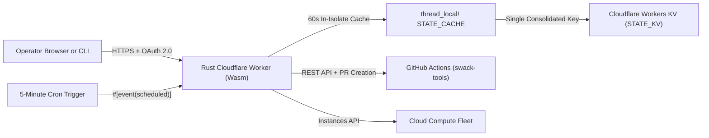

# Customize `GitHub` runners for `swack-tools` and create the `Cloudflare` control plane

This guide explains how to create and deploy a pure-Rust Cloudflare Worker backed by Cloudflare Workers `KV`, and how to customize persistent GitHub Actions runners for `swack-tools` repositories by using declarative runner patch manifests and the native Rust host agent.

## Part 1 for creating and deploying the `Cloudflare` control plane

The edge control plane runs as a serverless Cloudflare Worker compiled from Rust to `wasm32-unknown-unknown`. It stores all state inside a single consolidated Cloudflare Workers `KV` document, serves the management web interface in under 15 milliseconds, and runs a 5-minute scheduled cron reconciler without requiring always-on control virtual machines (VMs) or Cloudflare Tunnels.



### Step 1 for authenticating `Wrangler` and creating the `KV` namespace

Install the Cloudflare `wrangler` command-line tool and `worker-build`, then authenticate with your Cloudflare account:

```bash
cargo install worker-build
wrangler login
export CLOUDFLARE_ACCOUNT_ID="your-cloudflare-account-id"
```

Create the production and preview Workers `KV` namespaces:

```bash
wrangler kv namespace create STATE_KV
wrangler kv namespace create STATE_KV --preview
```

Copy the namespace identifier returned by Wrangler and replace `REPLACE_WITH_KV_NAMESPACE_ID` in `cloudflare/wrangler.toml`:

```toml
name = "cf-worker-kv-template"
main = "build/worker/shim.mjs"
compatibility_date = "2026-06-01"
workers_dev = false
preview_urls = false

kv_namespaces = [
  { binding = "STATE_KV", id = "REPLACE_WITH_KV_NAMESPACE_ID" },
]

[build]
command = "worker-build --release"

[vars]
SESSION_NOT_BEFORE = ""
GITHUB_ORG = "swack-tools"
DEFAULT_TARGET_REPO = "swack-tools/oxidex"

[triggers]
crons = ["*/5 * * * *"]

[observability]
enabled = true
```

### Step 2 for provisioning `Cloudflare` worker secrets

Never store secrets in `wrangler.toml` or commit them to Git. Provision each secret through `wrangler secret put`:

```bash
cd cloudflare

# 32-byte hex secret used to sign HMAC-SHA256 session cookies
openssl rand -hex 32 | wrangler secret put SESSION_SECRET

# GitHub OAuth 2.0 application credentials for operator sign-in
wrangler secret put GITHUB_OAUTH_CLIENT_ID
wrangler secret put GITHUB_OAUTH_CLIENT_SECRET

# Renewable GitHub token or App credentials for runner JIT registration
wrangler secret put GITHUB_RUNNER_TOKEN

# Cloud provider service account JSON key for fleet reconciliation
wrangler secret put GCP_SERVICE_ACCOUNT_KEY
```

### Step 3 for verifying `KV` quota invariants before deploying

To operate reliably within Cloudflare Free Tier limits (100,000 `KV` reads per day and 1,000 `KV` writes per day), the Rust Worker enforces four storage rules in `cloudflare/src/state.rs`:

1. **Consolidated document key (`app:state`)**: all configuration, runner profiles, administrator records, and fleet telemetry reside in a single JSON envelope (`StateBundle`). Loading or persisting state uses at most one `KV` operation.
2. **In-isolate memory cache (`thread_local!`)**: each Worker isolate caches the parsed `StateBundle` in memory for 60 seconds (`STATE_CACHE_TTL_SECS`). Read endpoints (`/`, `/api/health`, `/api/state`, `/api/items`) serve warm requests in under 0.1 milliseconds with zero `KV` reads.
3. **`SHA-256` fingerprint diff-gating**: before writing to `KV`, `save_state_if_changed` hashes the canonical JSON payload with `SHA-256` (`state_fingerprint`). If a 5-minute cron tick produces no state change, the Worker skips `kv.put(...)` completely (`WriteOutcome::SkippedUnchanged`).
4. **Distributed lease locking (`app:lease`)**: scheduled cron reconcilers acquire a short-lived `KV` lease via `acquire_lease` before mutating state so overlapping ticks never overwrite concurrent operator updates.

Run the native Rust test suite and build the release Wasm bundle to verify these invariants locally:

```bash
cargo test --manifest-path cloudflare/Cargo.toml
cd cloudflare && worker-build --release
```

### Step 4 for deploying the worker and verifying edge endpoints

Deploy the compiled WebAssembly Worker to Cloudflare's edge network:

```bash
cd cloudflare && wrangler deploy
```

Verify the deployment by querying the read-only health endpoint:

```bash
curl -sS https://your-worker-domain.example.com/api/health | jq .
```

## Part 2 for customizing `GitHub Actions` runners for `swack-tools`

Repositories in the `swack-tools` organization customize their GitHub Actions runner hosts and runner containers declaratively through `spot-runner-patch-v1` manifests rather than manual SSH edits.

### Where `swack-tools` runner manifests live

Runner patch manifests live in a central configuration repository (`swack-tools/spot-runners-config` by default):

| Path | Scope | Purpose |
| --- | --- | --- |
| `defaults.yaml` | Organization-wide (`swack-tools`) | Base hardware sizing, kernel parameters, and packages inherited by every repository. |
| `repos/swack-tools/<repo>.yaml` | Single repository (for example, `repos/swack-tools/oxidex.yaml`) | Repository-specific hardware, `ISA`, package, sysctl, file, and container mount overrides. |

When rendering a runner configuration for `swack-tools/<repo>`, the loader fetches `defaults.yaml` and `repos/swack-tools/<repo>.yaml` from the pinned commit on the default branch, merges them deterministically, validates the combined manifest, and computes the canonical `SHA-256` patch digest.

### Write a `spot-runner-patch-v1` manifest for `swack-tools`

A runner patch manifest contains three primary sections: `hardware`, `host`, and `container`. Below is a complete example for `repos/swack-tools/oxidex.yaml`:

```yaml
schema: spot-runner-patch-v1
repository: swack-tools/oxidex

hardware:
  arch: x86_64
  isa:
    - avx2
    - avx512
  extra_labels:
    - rust-1.99
    - avx512-verified
  min_vcpu: 16
  min_ram_gib: 32
  runners_count: 2
  runner_vcpu: 7
  runner_ram_gib: 14
  host_overhead_gib: 4
  queued_jobs_threshold: 20
  qualify_command: |
    rustc --version
    cargo --version

host:
  apt_packages:
    - jq
    - socat
    - zstd
  sysctl:
    vm.max_map_count: "262144"
    fs.inotify.max_user_watches: "524288"
  boot_mkdirs:
    - /mnt/runner-data/cargo-cache
  files:
    - path: /etc/runner-environment.conf
      content: |
        OXIDEX_CLEAN_TARGET=1
      mode: "0644"
      owner: root:root
  boot_script: |
    chmod 0755 /mnt/runner-data/cargo-cache

container:
  apt_packages:
    - clang
    - lld
    - pkg-config
    - libssl-dev
  sysctl:
    net.ipv4.ip_local_port_range: "10240 65535"
  mounts:
    - source: /mnt/runner-data/cargo-cache
      target: /work/.cargo
      read_only: false
  dockerfile_run: |
    rustup component add clippy rustfmt
```

### Understand hardware sizing and `CPU` instruction set filtering

The `hardware` section governs how the Cloudflare Worker reconciler selects cloud machine families and sizes runner containers:

- **Memory and `CPU` allocation**: on a 16-vCPU, 32 GiB RAM host, reserving `host_overhead_gib: 4` leaves 28 GiB for two runner containers (`runners_count: 2`), each capped at `runner_vcpu: 7` and `runner_ram_gib: 14`.
- **Instruction set architecture (`isa`) filtering**: declaring `avx2`, `avx512`, `avx512-vbmi2`, `amx`, or `avx10.1` on `x86_64` (or `neon`, `sve`, and `sve2` on `arm64`) restricts provisioning to cloud machine families whose `CPU` platforms expose the corresponding `/proc/cpuinfo` flags.
- **Backlog scaling (`queued_jobs_threshold`)**: when queued workflow jobs for `swack-tools` reach or exceed the configured threshold (for example, `20`), the 5-minute Worker reconciler provisions additional Spot runner hosts and mints 2-slot Just-in-Time (`JIT`) runner configurations through the GitHub Actions API.

### Merge rules between `defaults.yaml` and repository overrides

When the Worker merges `defaults.yaml` with `repos/swack-tools/<repo>.yaml`, it applies deterministic per-field rules:

| Field group | Merge behavior |
| --- | --- |
| Scalar hardware settings (`arch`, `min_vcpu`, `min_ram_gib`, `runners_count`, `runner_vcpu`, `runner_ram_gib`, `host_overhead_gib`, `queued_jobs_threshold`) | Repository value overrides the default when present. |
| Lists (`isa`, `extra_labels`, `apt_packages`, `boot_mkdirs`) | Union with default entries first and duplicates removed. |
| Key-value mappings (`sysctl`) | Merged by key; the repository value wins on conflicts. |
| File lists (`host.files`, `container.files`) and `container.mounts` | Merged by `path` (for files) or `target` (for mounts), replacing matching default entries. |
| Scripts (`boot_script`, `dockerfile_run`) | Concatenated with a newline, default script first. |

### Enforce host and container security boundaries

Customizations applied to `swack-tools` runners must preserve four runtime security invariants enforced by the validator and the native pure-Rust `host-agent` binary:

1. **Forbidden container mounts**: `container.mounts` strictly rejects `/var/run/docker.sock`, `/run/docker.sock`, `/run/gha-admission`, `/var/lib/gha-admission`, `/etc`, `/root`, `/proc`, `/sys`, `/dev`, and any parent or child path of those directories.
2. **Memory lease admission (`host-agent host-admission`)**: registered GitHub listener counts do not equal concurrent memory capacity. Before a workflow job runs, `runner/job-started.sh` acquires a memory lease over `/run/gha-admission/socket` backed by `/var/lib/gha-admission/leases.json`, blocking if active jobs would exceed host headroom.
3. **Descriptor-safe workspace cleanup (`host-agent clean-target`)**: when a job finishes, `runner/job-completed.sh` invokes `host-agent clean-target` to remove the workspace `target/` directory using descriptor-relative `unlinkat` with `AT_SYMLINK_NOFOLLOW`, preventing symlink traversal outside the workspace.
4. **Loopback port wrapping (`host-agent docker-wrapper`)**: intercepts container launch commands to bind published ports to `127.0.0.1` and manage local `socat` relays.

### Apply runner patches through the patch console

Instead of editing runner hosts by hand, apply changes through the Cloudflare Worker dashboard:

1. Open the Worker dashboard, sign in with GitHub OAuth 2.0, and select the **Runner Patch Console** tab.
2. Choose `swack-tools/<repo>` (or `defaults.yaml`) to load the current manifest and its merged canonical `SHA-256` digest.
3. Edit the YAML manifest and run validation. The pure-Rust validator rejects unknown keys, invalid package names, and forbidden mount paths immediately.
4. Save the patch to open a branch and pull request against `swack-tools/spot-runners-config`.
5. Once the pull request merges to `main`, the Cloudflare Worker reconciler detects the updated canonical `SHA-256` digest on its next cron tick and rolls out the customization across the runner fleet.
