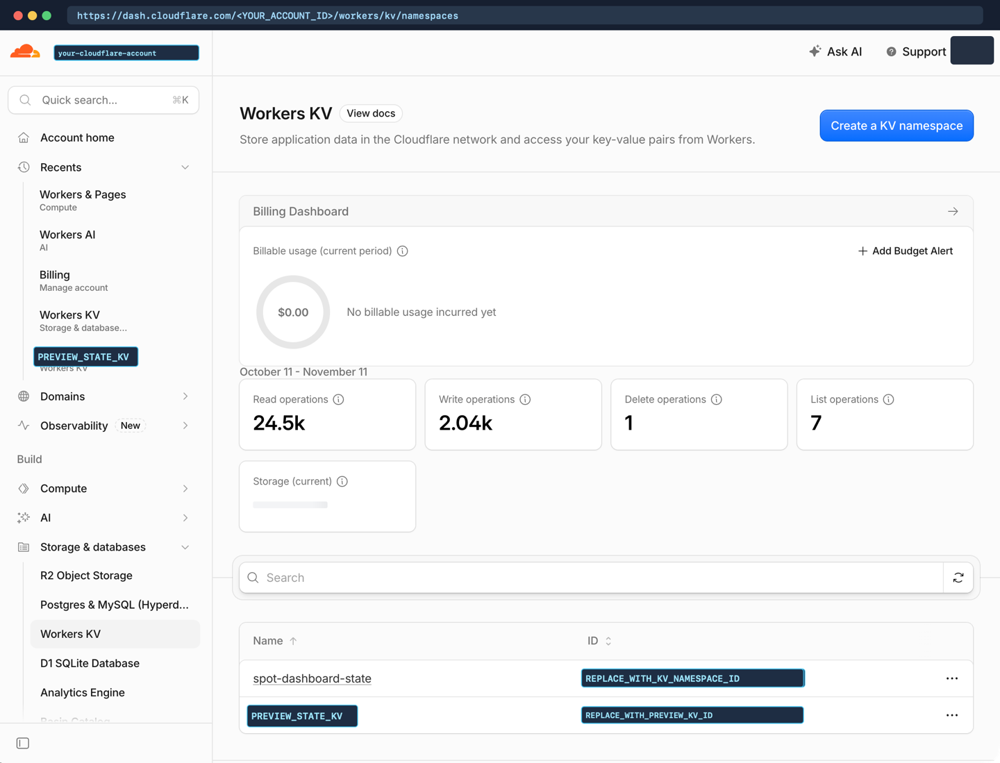
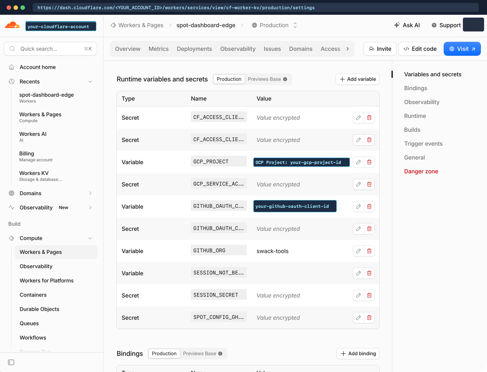
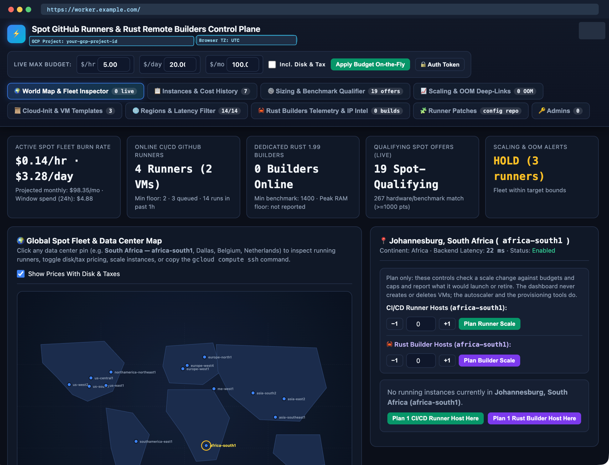

# Cloudflare worker and `KV` template

This template repository provides a production-grade starting point for building 100% pure-Rust serverless edge apps on **Cloudflare Workers** (`workers-rs`, compiled to `wasm32-unknown-unknown`) that use **Cloudflare Workers `KV`** as durable state storage.

It is pre-configured out of the box for three major AI coding harnesses (**Claude Desktop and Claude Code**, **ChatGPT and OpenAI Codex Desktop**, and **Google Antigravity Desktop and IDE**), enforces the **Google developer documentation style guide** with **Vale**, and publishes strict **MkDocs Material** documentation to **GitHub Pages**.

## Core capabilities

| Capability | Implementation | Documentation |
| --- | --- | --- |
| **Pure-Rust Cloudflare Worker + `KV` state engine** | Single consolidated `KV` document (`app:state`), 60-second in-isolate `thread_local!` cache, `SHA-256` `state_fingerprint` diff-gating, distributed `KV` lease locks, and native `InMemoryKvStore` testing in `cloudflare/`. | [KV state architecture](kv-state-architecture.md) |
| **Dual-runtime `Cloudflare` Edge + `wasmCloud` support** | Write Wasm components in Rust with `workers-rs` (`wasm32-unknown-unknown`) binding `worker::kv::KvStore` directly, and run the same state engine on `wasmCloud` (`wasm32-wasip2` + `wasi:keyvalue`) via `WasmCloudKvAdapter`. | [Cloudflare edge and wasmCloud](wasmcloud-and-cloudflare-edge.md) |
| **Multi-harness AI model routing** | Pre-wired instructions in `CLAUDE.md` (`@read AGENTS.md`), `AGENTS.md`, `GEMINI.md`, and `.agents/rules/routing.md` mapping task complexity across Claude, Codex, and Antigravity. | [AI harnesses and model routing](ai-harnesses-and-routing.md) |
| **Vale Google style guide and GitHub Pages** | `.vale.ini` with `BasedOnStyles = Google`, `mkdocs.yml` in strict mode, pinned `docs/requirements.txt`, and `SHA`-pinned `.github/workflows/docs.yml`. | [Style guide and GitHub Pages setup](style-guide-and-github-pages.md) |
| **`swack-tools` runner customization and Cloudflare setup** | Step-by-step runbook for provisioning the Cloudflare Worker and `KV` namespace and customizing GitHub Actions runners with `spot-runner-patch-v1` manifests. | [Customize GitHub runners and Cloudflare](customizing-github-runners-and-cloudflare.md) |

## Quick start

Run these read-only verification commands from the repository root to test the Rust Worker, build the WebAssembly bundle, and lint the documentation:

```bash
# 1. Run all unit, concurrency, lease-locking, and KV quota tests natively
cargo test --manifest-path cloudflare/Cargo.toml

# 2. Check Rust formatting and compiler warnings
cargo fmt --manifest-path cloudflare/Cargo.toml -- --check

# 3. Compile the Cloudflare Worker to WebAssembly
cd cloudflare && worker-build --release && cd ..

# 4. Synchronize Vale and verify Google developer documentation style
vale sync
vale README.md AGENTS.md CLAUDE.md GEMINI.md docs/*.md
```

## Visual walkthrough preview

See [Customize GitHub runners and Cloudflare](customizing-github-runners-and-cloudflare.md) and [Style guide and GitHub Pages setup](style-guide-and-github-pages.md) for the complete 14-screenshot visual configuration runbook:






