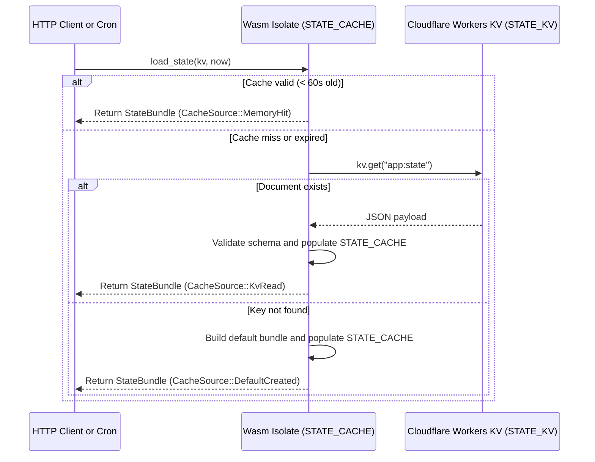

# Consolidated `KV` state architecture

This page explains the storage design implemented in `cloudflare/src/state.rs`, `cloudflare/src/reconciler.rs`, and `cloudflare/src/auth.rs` for using Cloudflare Workers `KV` as app state storage in pure Rust.

## Design goals and quota constraints

Cloudflare Workers `KV` is a globally distributed, eventually consistent key-value store optimized for high-read, low-write workloads. On the Cloudflare Free Tier, accounts receive 100,000 reads per day and 1,000 writes per day. Even on paid plans, scattering app state across many fine-grained `KV` keys increases tail latency and multiplies read and write operations.

This template solves those constraints with four architectural patterns:

1. **Single consolidated state document (`app:state`)**: all app state, items, configuration, and reconciliation telemetry live inside one versioned JSON envelope (`StateBundle`).
2. **In-isolate Wasm memory cache (`thread_local!`)**: warm Worker isolates serve reads from memory with a 60-second time to live (`TTL`), reducing `KV` read volume by more than 95% and responding in under 0.1 milliseconds.
3. **Canonical `SHA-256` fingerprint diff-gating**: background cron ticks compute the `SHA-256` digest of the canonical state JSON and skip `kv.put(...)` whenever the digest is unchanged.
4. **Distributed `KV` lease locking (`app:lease`)**: scheduled reconcilers acquire a time-bounded lease in `KV` before mutating state so concurrent ticks do not race.

## Consolidated document envelope

All state stored under `app:state` (`KV_STATE_KEY`) uses the `StateBundle` structure in `cloudflare/src/state.rs`:

| Field | Type | Description |
| --- | --- | --- |
| `schema` | `String` | Fixed schema version `cf-kv-state-snapshot-v1`. Deserialization rejects mismatched schemas. |
| `state_version` | `u64` | Monotonically increasing version counter incremented on every persisted write. |
| `writer_slot` | `String` | Identifier of the writer (`edge` for HTTP handlers or `reconciler` for cron ticks). |
| `written_at` | `u64` | Unix epoch timestamp (seconds) of the last write. |
| `state_fingerprint` | `String` | Hex-encoded `SHA-256` digest of the canonical `AppState` JSON payload. |
| `state` | `AppState` | App state containing `organization`, `environment`, `items`, `reconciler_telemetry`, and `admins`. |

## Read and write lifecycle



### Diff-gated persistence (`save_state_if_changed`)

When a scheduled cron tick or idempotent endpoint calls `save_state_if_changed(kv, &mut bundle, writer_slot, now)`:

1. The Worker computes `new_fingerprint = compute_state_fingerprint(&bundle.state)`.
2. If `bundle.state_version > 0` and `bundle.state_fingerprint == new_fingerprint`, the Worker updates the in-isolate cache timestamp and returns `WriteOutcome::SkippedUnchanged` without calling `kv.put(...)`.
3. If the fingerprint changed, the Worker increments `bundle.state_version`, sets `bundle.written_at = now`, updates `bundle.state_fingerprint = new_fingerprint`, writes the serialized JSON to `app:state`, refreshes `STATE_CACHE`, and returns `WriteOutcome::Written`.

## Dual-target testing with `KvStoreBackend`

Because `worker::kv::KvStore` depends on JavaScript host bindings available only on `wasm32-unknown-unknown`, coupling state logic directly to `worker::kv::KvStore` prevents running standard `cargo test` on macOS or Linux.

`cloudflare/src/state.rs` defines the `KvStoreBackend` trait:

```rust
#[async_trait::async_trait(?Send)]
pub trait KvStoreBackend {
    async fn get(&self, key: &str) -> Result<Option<String>, StateError>;
    async fn put(&self, key: &str, value: &str) -> Result<(), StateError>;
    async fn delete(&self, key: &str) -> Result<(), StateError>;
}
```

- On `wasm32-unknown-unknown`, `worker::kv::KvStore` implements `KvStoreBackend` directly.
- In native tests (`cargo test`), `InMemoryKvStore` implements `KvStoreBackend` and tracks exact read, write, and delete counters (`read_count()`, `write_count()`, `delete_count()`) so tests can assert that idle cron ticks perform zero `KV` writes.
