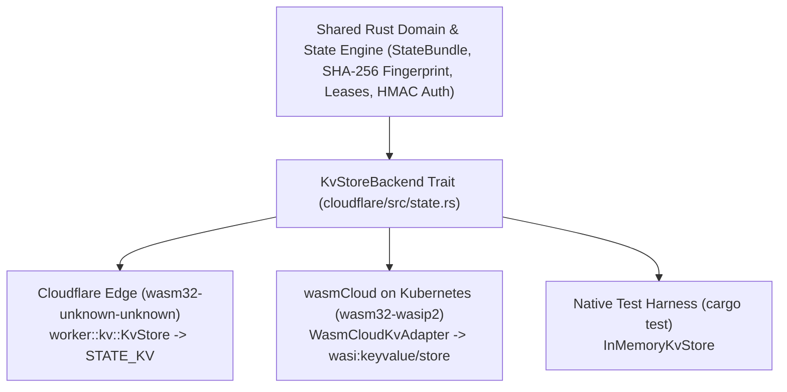

# Run `Rust` `WebAssembly` on `Cloudflare` edge and `wasmCloud`

This guide explains how this template structures pure-Rust WebAssembly components so the exact same state machine, `SHA-256` fingerprint diff-gating, distributed lease locking, and `HMAC-SHA256` authentication run natively on both **Cloudflare Workers (`wasm32-unknown-unknown` + `worker::kv::KvStore`)** and **`wasmCloud` on Kubernetes (`wasm32-wasip2` + `wasmcloud:keyvalue` / `wasi:keyvalue`)**.

## Dual-runtime architecture overview

| Dimension | `Cloudflare` Edge + `KV` | `wasmCloud` on Kubernetes |
| --- | --- | --- |
| **Compilation target** | `wasm32-unknown-unknown` (packaged by `worker-build`) | `wasm32-wasip2` (WebAssembly Component Model) |
| **Rust SDK and entrypoint** | `workers-rs` (`worker` crate, `#[event(fetch)]` and `#[event(scheduled)]`) | `wasmcloud-component` (`wasi:http/incoming-handler`) |
| **Direct `KV` binding** | `worker::kv::KvStore` via `env.kv("STATE_KV")?` | `wasi:keyvalue/store` (`wasmcloud:keyvalue`) bucket |
| **Storage trait implementation** | `impl KvStoreBackend for worker::kv::KvStore` | `impl<B: WasiKeyValueBucket> KvStoreBackend for WasmCloudKvAdapter<B>` |
| **Underlying backing store** | Globally replicated Cloudflare Workers `KV` | Kubernetes-hosted NATS JetStream, Redis, or Valkey capability provider |



## Part 1 for using Wasm at `Cloudflare` edge with `Workers KV`

On Cloudflare's edge network, you write WebAssembly components in Rust by using `workers-rs` (`worker = "0.8.7"` in `cloudflare/Cargo.toml`), compile them to `wasm32-unknown-unknown` with `worker-build --release`, and bind Cloudflare Workers `KV` directly through `worker::kv::KvStore`.

### Bind `worker::kv::KvStore` directly in `workers-rs`

In `cloudflare/src/lib.rs`, both HTTP handlers (`#[event(fetch)]`) and cron triggers (`#[event(scheduled)]`) obtain the `worker::kv::KvStore` binding directly from the Worker `Env` and pass it to the state engine:

```rust
use worker::*;
use crate::state::{load_state, save_state_if_changed, WRITER_SLOT_EDGE};

#[event(fetch)]
pub async fn fetch(req: Request, env: Env, _ctx: Context) -> Result<Response> {
    // Bind Cloudflare Workers KV directly through worker::kv::KvStore
    let kv: worker::kv::KvStore = env.kv("STATE_KV")?;
    let now = crate::current_time_epoch();

    let (bundle, cache_source) = load_state(&kv, now)
        .await
        .map_err(|e| Error::RustError(e.to_string()))?;

    Response::from_json(&serde_json::json!({
        "cache_source": cache_source,
        "bundle": bundle,
    }))
}
```

### Direct `KvStoreBackend` implementation for `worker::kv::KvStore`

`cloudflare/src/state.rs` implements `KvStoreBackend` directly on `worker::kv::KvStore`:

```rust
#[async_trait::async_trait(?Send)]
impl KvStoreBackend for worker::kv::KvStore {
    async fn get(&self, key: &str) -> Result<Option<String>, StateError> {
        self.get(key)
            .text()
            .await
            .map_err(|e| StateError::Kv(e.to_string()))
    }

    async fn put(&self, key: &str, value: &str) -> Result<(), StateError> {
        self.put(key, value)
            .map_err(|e| StateError::Kv(e.to_string()))?
            .execute()
            .await
            .map_err(|e| StateError::Kv(e.to_string()))
    }

    async fn delete(&self, key: &str) -> Result<(), StateError> {
        self.delete(key)
            .await
            .map_err(|e| StateError::Kv(e.to_string()))
    }
}
```

Because `worker::kv::KvStore` is single-threaded inside a Wasm isolate, `#[async_trait::async_trait(?Send)]` avoids requiring `Send` bounds while allowing zero-cost async dispatch on `wasm32-unknown-unknown`.

## Part 2 for running the same Rust worker on `wasmCloud` and Kubernetes

When deploying to Kubernetes with `wasmCloud`, components target `wasm32-wasip2` and access key-value state through the standardized `wasi:keyvalue/store` (`wasmcloud:keyvalue`) interface rather than JavaScript host bindings.

### Bridge `wasi:keyvalue` with `WasiKeyValueBucket` and `WasmCloudKvAdapter`

`cloudflare/src/state.rs` provides `WasiKeyValueBucket` and `WasmCloudKvAdapter<B>`, which adapt any byte-oriented `wasi:keyvalue/store` bucket into a `KvStoreBackend`:

```rust
pub trait WasiKeyValueBucket {
    fn get_bytes(&self, key: &str) -> Result<Option<Vec<u8>>, String>;
    fn set_bytes(&self, key: &str, value: &[u8]) -> Result<(), String>;
    fn delete_key(&self, key: &str) -> Result<(), String>;
}
```

In a `wasmCloud` component crate (compiled to `wasm32-wasip2`), implement `WasiKeyValueBucket` for `wasi::keyvalue::store::Bucket` and pass `WasmCloudKvAdapter::new(bucket)` directly into `load_state`, `save_state_if_changed`, `acquire_lease`, and `run_reconciliation_tick`:

```rust
use cf_worker_kv_template::state::{
    load_state, save_state_if_changed, WasiKeyValueBucket, WasmCloudKvAdapter, WRITER_SLOT_EDGE,
};

pub struct WasiBucketHandle {
    bucket: wasmcloud_component::wasi::keyvalue::store::Bucket,
}

impl WasiKeyValueBucket for WasiBucketHandle {
    fn get_bytes(&self, key: &str) -> Result<Option<Vec<u8>>, String> {
        self.bucket.get(key).map_err(|e| format!("{e:?}"))
    }

    fn set_bytes(&self, key: &str, value: &[u8]) -> Result<(), String> {
        self.bucket.set(key, value).map_err(|e| format!("{e:?}"))
    }

    fn delete_key(&self, key: &str) -> Result<(), String> {
        self.bucket.delete(key).map_err(|e| format!("{e:?}"))
    }
}
```

### Deploy on Kubernetes with a `wadm.yaml` manifest

On Kubernetes running the `wasmCloud` operator, wire the Rust WebAssembly component to an HTTP server provider and a `wasi:keyvalue` capability provider (backed by NATS JetStream or Redis) using a declarative `wadm.yaml` manifest:

```yaml
apiVersion: core.oam.dev/v1beta1
kind: Application
metadata:
  name: rust-kv-edge-worker
  annotations:
    version: v0.1.0
    description: "Portable Rust Wasm worker using wasi:keyvalue on Kubernetes"
spec:
  components:
    - name: rust-kv-worker
      type: component
      properties:
        image: ghcr.io/swack-tools/webassemply-template:v0.1.0
      traits:
        - type: spreadscaler
          properties:
            instances: 4
        - type: link
          properties:
            target: kv-jetstream
            namespace: wasi
            package: keyvalue
            interfaces: [store]
            target_config:
              - name: state-bucket
                properties:
                  bucket: STATE_KV

    - name: http-server
      type: capability
      properties:
        image: ghcr.io/wasmcloud/http-server:0.23.0
      traits:
        - type: link
          properties:
            target: rust-kv-worker
            namespace: wasi
            package: http
            interfaces: [incoming-handler]
            source_config:
              - name: default-http
                properties:
                  address: 0.0.0.0:8080

    - name: kv-jetstream
      type: capability
      properties:
        image: ghcr.io/wasmcloud/keyvalue-nats-kv:0.4.0
```

### Why the consolidated document pattern benefits both runtimes

Preserving the single consolidated document (`app:state`), `SHA-256` fingerprint diff-gating, and `thread_local!` isolate caching improves performance on both platforms:

- **On Cloudflare Workers**: keeps daily `KV` read and write operations well within Free Tier limits and serves warm isolate reads in under 0.1 milliseconds.
- **On `wasmCloud` + Kubernetes**: minimizes NATS JetStream or Redis round trips across pod boundaries, ensures atomic single-key state updates (`app:state`), and prevents redundant raft log growth on no-op reconciliation ticks.
